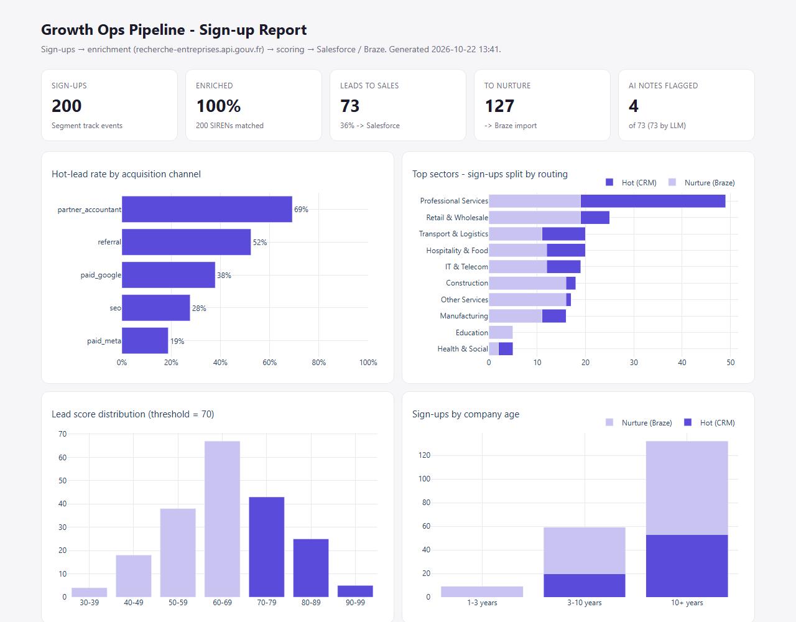
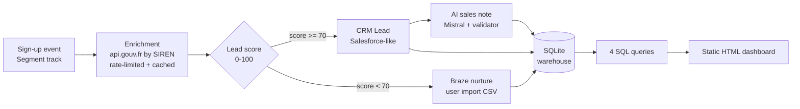

# qonto-growth-ops-pipeline

**Every new sign-up is a lead, but Sales can't call 200 companies a day, and the raw sign-up event only says "SIREN 478455793 signed up from a Facebook ad".** This pipeline does what a Growth Ops team automates between Segment, Salesforce and Braze: it enriches each sign-up with public company data (sector, headcount, age, city, legal form), scores it with transparent rules, sends the best leads to the CRM with an AI-written sales note (checked for hallucinations), puts everyone else into a Braze nurture journey, and turns the result into a one-page report that a non-technical Growth lead can read in 30 seconds.



## Data flow



| Step | File | Output |
|---|---|---|
| 1. Sign-up events | `src/ingest.py` | 200 real SMEs from 10 search terms → `Account Signed Up` events in Segment format (`data/raw/signup_events.jsonl`) |
| 2. Enrichment | `src/enrich.py`, `src/api_client.py` | NAF code + label, headcount bracket, creation date / age, city, legal form → `companies` table |
| 3. Scoring | `src/score.py` | 4-part score → `scored_leads` table |
| 4. Routing | `src/route.py` | Hot → `crm_leads` table · Others → `braze_nurture` table + `output/braze_nurture.csv` |
| 5. AI notes | `src/ai_notes.py` | One-line note per CRM lead + validation flags |
| 6. Report | `src/report.py`, `sql/*.sql` | `output/dashboard.html` (single file, works offline) |

## Run it (3 commands)

```bash
python -m venv .venv && .venv\Scripts\activate      # macOS/Linux: source .venv/bin/activate
pip install -r requirements.txt
python run_pipeline.py                               # then open output/dashboard.html
```

**Interactive console:** `python -m web.server` → http://127.0.0.1:5000. It has an overview with a threshold simulator, a searchable lead list with a detail panel for each lead (score breakdown, enrichment, AI note and flags, raw Segment event), a SQL tab with the 4 queries plus a read-only editor, and the scoring rules read live from `config.yaml`. It's Flask + plain JavaScript with no build step, and reads the SQLite db through a read-only connection.

Optional: `copy .env.example .env` and add a `MISTRAL_API_KEY` for LLM notes. Without it, a template note is used and the pipeline still runs end to end.
Run a single step with `python run_pipeline.py --stage enrich` (`ingest|enrich|score|ai|report`). Tests: `pytest`.

Everything you can tune (number of companies, channels and UTMs, score weights, threshold, LLM model) is in **`config.yaml`**.

## Lead scoring rules

Score = **headcount (max 35) + company age (max 25) + sector (max 20) + channel (max 20)** = 0-100.

| Component | Rule | Why |
|---|---|---|
| Headcount (INSEE bracket, lower bound) | 0 → 5 · 1-9 → 15 · 10-49 → 30 · **50-249 → 35** · 250+ → 20 · unknown → 5 | Teams with several users and cards are worth a call; very large companies are a different sales motion |
| Company age | <1 yr → 10 · 1-3 → 15 · **3-10 → 25** · 10+ → 20 · unknown → 5 | Established SMEs switching banks have more volume to move than brand-new companies |
| Sector (NAF section) | IT/Telecom, Professional services → 20 · Construction, Trade, Business support → 15 · Hospitality → 10 · other → 5 | Assumed best fit; in production this would be learned from historical conversion |
| Channel | Accountant partner → 20 · Referral → 15 · Paid search, SEO → 10 · Paid social → 5 | High-intent channels convert better |

**≥ 70 → CRM** (Rating `Hot` from 85, otherwise `Warm`). OwnerQueue: `Partnerships` for accountant leads, `MidMarket_AE` from 50 employees, otherwise `SMB_Outbound`.
**< 70 → Braze** with a `nurture_track` attribute (`new_business_onboarding`, `solo_founder_tips`, `team_features_upsell`) used to trigger the right Canvas.

Each component is stored separately (`pts_headcount`, `pts_age`, …), so anyone can see *why* a lead got its score. The threshold is a business decision: `sql/03_score_distribution.sql` shows how many leads Sales would get at each threshold.

## SQL insights (`/sql`)

| Query | Question it answers | SQL techniques |
|---|---|---|
| `01_hot_leads_by_channel.sql` | Which channels bring leads Sales wants? | CTE, conditional aggregation |
| `02_top_sectors.sql` | Which sectors should the next campaign target? | CTE, `RANK() OVER`, `SUM() OVER ()` share of total |
| `03_score_distribution.sql` | How many leads would Sales get at threshold X? | CTE, running `SUM() OVER (ORDER BY …)` |
| `04_signups_by_company_age.sql` | New businesses or bank-switchers? | CTE, `CASE` bucketing |

From this run: accountant partners send **69%** hot leads vs **19%** for Meta ads. (Caveat: channel is also one of the score's inputs, so part of the gap comes from the rules themselves. The real test would be against closed-won deals.)

## AI step and hallucination check

For each CRM lead, `ministral-8b` gets **only** the enriched facts (as JSON) and writes one line for the sales rep. Every note, from the LLM or the template, then goes through `validate_note()`, which flags:
- **numbers not in the data** ("15-person team" when the data says "No employees"),
- **claims we can't have** (revenue, funding, profit, discount, `%`, `€`, fast-growing…),
- **wrong city** (mentions a major city that isn't the lead's own),
- notes that aren't one line.

Flagged notes stay in the CRM row with `Note_Flags__c` filled in, and the dashboard lists them for review. Real catch from a run: *"…Offer 10% discount on first 3 months"*, a commercial promise the model invented. Notes are cached per (model, prompt, facts), so reruns cost nothing. A circuit breaker switches to template notes if the LLM API keeps failing.

## How this maps to the real stack

| Here | In production at Qonto |
|---|---|
| `signup_events.jsonl` in Segment `track` format | Segment source (web/app SDK) → Segment destination / warehouse |
| `CompanyApiClient` (rate limit, cache, retries) | Same pattern in a serverless function or Segment Function, cache in Redis / warehouse |
| `crm_leads` table with `Company`, `Industry`, `NumberOfEmployees`, `LeadSource`, `Rating`, `OwnerQueue` | Salesforce Lead upsert via REST/Bulk API on an External ID (`SIREN__c`), assignment rules → queue |
| `braze_nurture.csv` (`external_id` + attributes) | Braze `/users/track` API or Segment → Braze destination, `nurture_track` triggers a Canvas |
| `utm_*` properties | Meta / Google Ads attribution; hot-lead events sent back as offline conversions (Meta Conversions API) to optimise ads for *quality* sign-ups, not volume |
| SQLite + `/sql` | Warehouse (BigQuery/Snowflake) + dbt models |
| `dashboard.html` | Metabase / Looker dashboard |

### What I'd change in production
- **Event-driven, not batch:** a Segment webhook triggers enrichment → score → routing per sign-up within seconds, so Sales calls while intent is fresh.
- **Idempotency:** already keyed on Segment `messageId` / SIREN (`INSERT OR REPLACE`), so rerunning never duplicates. In Salesforce this becomes an upsert on an External ID.
- **Retries & dead-letter queue:** retries with backoff exist here; production adds a queue for events that still fail, plus alerts.
- **Monitoring:** enrichment match rate, API error rate, share of leads per queue, LLM flag rate, with an alert when one drifts (e.g. match rate < 90%).
- **GDPR & consent:** company data is public (INSEE/RNE), but sole traders (`Entrepreneur individuel`) are natural persons. Their data needs a legal basis, minimisation and a retention period. Braze marketing journeys must check the user's consent (Segment Consent Management) before sending. Only pseudonymous IDs leave the warehouse, and no personal data goes to the LLM.
- **Scoring:** start with rules (explainable, quick to agree on with Sales), then calibrate weights on historical won/lost deals and A/B test the threshold.
- **LLM:** move the prompt to a versioned config, add an LLM-as-judge or structured output, and sample flagged notes weekly.

## Project structure

```
run_pipeline.py      single entry point (--stage to run one step)
config.yaml          all thresholds, weights, channels, model
src/                 api_client, ingest, enrich, reference (code → label), score, route, ai_notes, report, db, config
sql/                 the 4 insight queries (also used by the dashboard)
templates/           dashboard HTML template (Jinja2)
web/                 local console: server.py (Flask API, read-only) + static/ (HTML/CSS/JS)
tests/               pytest: scoring rules, enrichment parsing, note validator (19 tests, no network)
data/  output/       gitignored: raw events, API cache, SQLite db, dashboard, Braze CSV
```

*Company data: [recherche-entreprises.api.gouv.fr](https://recherche-entreprises.api.gouv.fr) (public, no key). Sign-up events, channels and plans are simulated. Not affiliated with Qonto.*
