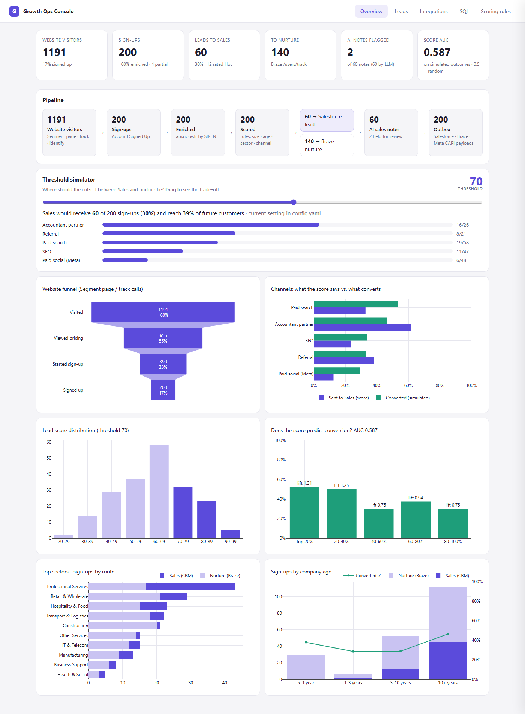
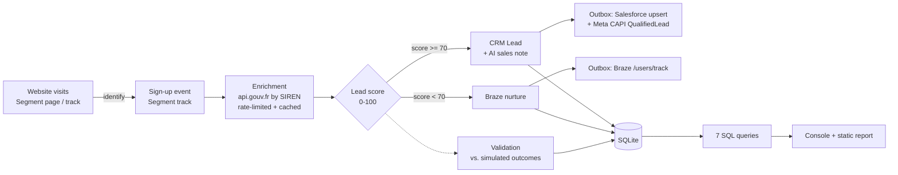

# qonto-growth-ops-pipeline

[](https://github.com/assim-ben-ahmed/qonto-growth-ops-pipeline/actions/workflows/ci.yml)
**[Live demo →](https://assim-ben-ahmed.github.io/qonto-growth-ops-pipeline/)**

**Every new sign-up is a lead, but Sales can't call 200 companies a day, and the raw sign-up event only says "SIREN 478455793 signed up from a Facebook ad".** This pipeline does what a Growth Ops team automates between Segment, Salesforce, Braze and Meta:
- it tracks the website journey before sign-up (page views, UTMs, ad click ids, identity stitching),
- it enriches each sign-up with public company data and scores it with transparent rules,
- it **checks the score against outcomes** instead of trusting it,
- it routes the best leads to Salesforce with an AI-written sales note (checked for hallucinations) and everyone else to a Braze nurture journey,
- it builds the exact API payloads for Salesforce, Braze and the Meta Conversions API (dry run).



## Data flow



| Step | File | Output |
|---|---|---|
| 1. Sign-ups | `src/ingest.py` | 200 real companies in 2 cohorts (170 established SMEs, 30 created in the last year) → `Account Signed Up` events in Segment format |
| 1b. Website tracking | `src/tracking.py` | 1,191 visitors and 2,637 Segment calls. Converters: landing page (UTMs + fbclid/gclid) → pricing → `Signup Started` → `identify` → sign-up. The other visitors drop off along the way. → `web_events` table |
| 2. Enrichment | `src/enrich.py`, `src/api_client.py` | NAF code, headcount bracket, age, city, legal form → `companies` |
| 3. Scoring + routing | `src/score.py`, `src/route.py` | 4-part score → `scored_leads`, `crm_leads`, `braze_nurture` |
| 3b. Validation | `src/outcomes.py` | Simulated outcome per sign-up + AUC → `outcomes` |
| 4. AI notes | `src/ai_notes.py` | One-line note per CRM lead + validation flags |
| 5. Outbox | `src/outbox.py` | `output/outbox/*.json`: the real API requests, not sent |
| 6. Report | `src/report.py`, `sql/*.sql` | `output/dashboard.html` (single file, works offline) |

## Run it

```bash
python -m venv .venv && .venv\Scripts\activate      # macOS/Linux: source .venv/bin/activate
pip install -r requirements.txt
python run_pipeline.py                               # then open output/dashboard.html
```

- **Interactive console:** `python -m web.server`, then open http://127.0.0.1:5000. It has five tabs:
  - **Overview:** KPIs, the funnel, a threshold simulator, and 6 charts.
  - **Leads:** click any lead to see its score breakdown, AI note, simulated outcome, Segment journey and API payloads.
  - **Integrations:** the outbox files.
  - **SQL:** the 7 queries plus a read-only editor.
  - **Scoring rules:** read live from `config.yaml`.
- **One step only:** `python run_pipeline.py --stage score`. The stages are `ingest|enrich|score|validate|ai|outbox|report`. Re-scoring keeps the existing AI notes.
- **Tests:** `pytest`, 32 tests with no network.
- **LLM notes:** `copy .env.example .env` and add a `MISTRAL_API_KEY`. Without it, a template note is used and everything still runs.

Everything you can tune (cohorts, channels and UTMs, funnel rates, score weights, threshold, LLM model) is in **`config.yaml`**.

### Live demo (GitHub Pages)

`.github/workflows/pages.yml` runs on every push to `main`:
1. It runs the whole pipeline on a GitHub runner, reusing the API/LLM cache between runs.
2. `web/build_static.py` exports the console as static files. Each API endpoint is saved as a `.json` file, and the SQL tab runs in the browser on a copy of the SQLite file (sql.js).
3. The site is published to GitHub Pages. It is front end only, with no server.

`ci.yml` runs the tests on every push and pull request.

## Lead scoring rules

Score = **headcount (max 35) + company age (max 25) + sector (max 20) + channel (max 20)** = 0-100.

| Component | Rule | Why |
|---|---|---|
| Headcount (INSEE bracket, lower bound) | 0 → 5 · 1-9 → 15 · 10-49 → 30 · **50-249 → 35** · 250+ → 20 · unknown → 5 | Teams with several users and cards are worth a call; very large companies are a different sales motion |
| Company age | <1 yr → 10 · 1-3 → 15 · **3-10 → 25** · 10+ → 20 · unknown → 5 | Established SMEs switching banks have more volume to move |
| Sector (NAF section) | IT/Telecom, Professional services → 20 · Construction, Trade, Business support → 15 · Hospitality → 10 · other → 5 | Assumed best fit |
| Channel | Accountant partner → 20 · Referral → 15 · Paid search, SEO → 10 · Paid social → 5 | High-intent channels convert better |

**≥ 70 → CRM** (Rating `Hot` from 85, otherwise `Warm`). OwnerQueue: `Partnerships` for accountant leads, `MidMarket_AE` from 50 employees, otherwise `SMB_Outbound`.
**< 70 → Braze** with a `nurture_track` (`new_business_onboarding`, `solo_founder_tips`, `team_features_upsell`) that picks the Canvas.

## Does the score work? (validation)

The rules above are assumptions. To test them, each sign-up gets a **simulated outcome** ("paying customer within 60 days"). It comes from a hidden probability model in `src/outcomes.py` that the score never sees, and that **deliberately disagrees with the rules in a few places**, the way reality would. Then the same checks a real backtest on CRM history would use:

| Check | Result (this run) | What it tells us |
|---|---|---|
| **AUC** (chance a random converter outscores a random non-converter) | **0.59** | Better than random (0.5), but far from great: the rules need calibrating |
| Conversion by score group (`06_score_validation.sql`) | Top 40% convert at ~51%; bottom 60% at ~33% | The threshold region works; below it, the score barely separates |
| Channels on outcomes, not score (`07_channel_outcomes.sql`) | Paid search: ranked **3rd** by score, **1st** by conversion. Referral: 2nd → 4th | The channel weights are wrong. This is the circularity check: "% sent to Sales" partly reflects our own rules |
| Company age (`04_signups_by_company_age.sql`) | Companies < 1 year: **0** sent to Sales, yet **38%** convert (vs. 40% for established ones) | The age rule undervalues creators. They need a dedicated onboarding flow, not a lower priority |

The numbers are simulated, so the findings themselves aren't the point. The method is: with real won/lost deals, this exact workflow tells you which weights to change.

## SQL insights (`/sql`)

| Query | Question it answers | SQL techniques |
|---|---|---|
| `01_hot_leads_by_channel.sql` | Which channels bring leads Sales wants? | CTE, conditional aggregation |
| `02_top_sectors.sql` | Which sectors should the next campaign target? | CTE, `RANK() OVER`, `SUM() OVER ()` |
| `03_score_distribution.sql` | How many leads would Sales get at threshold X? | running `SUM() OVER (ORDER BY …)` |
| `04_signups_by_company_age.sql` | New businesses or bank-switchers, and do they convert? | CTE, `CASE` bucketing, `LEFT JOIN` |
| `05_website_funnel.sql` | Where do visitors drop off, per channel? | per-visitor CTE from raw events, `UNION ALL`, `FIRST_VALUE` / `LAG` over `PARTITION BY` |
| `06_score_validation.sql` | If Sales calls the top 20%, what share of customers do they reach? | `NTILE(5)`, lift, cumulative share |
| `07_channel_outcomes.sql` | Which channels does the score over- or under-value? | two `RANK()`s side by side |

Funnel example: paid social brings the most visitors (480) but only 10% sign up. Accountant partners send 39 visitors and 67% sign up.

## AI step and hallucination check

For each CRM lead, `ministral-8b` gets **only** the enriched facts (as JSON) and writes one line for the sales rep. Every note then goes through `validate_note()`, which flags:
- numbers not in the data,
- claims we can't have (revenue, funding, profit, discount, `%`, `€`, fast-growing…),
- a major city that isn't the lead's own,
- notes longer than one line.

Real catch from this run: *"O Conseils is a **fast-growing** SAS legal/accounting firm…"*. Nothing in the data says that. Flagged notes are **not sent to Salesforce**: the outbox sends `Sales_Note__c = null` and `Note_Needs_Review__c = true`. Notes are cached per (model, prompt, facts). A circuit breaker switches to template notes if the LLM API keeps failing.

## Integrations (outbox, dry run)

| File | Real endpoint | Details |
|---|---|---|
| `salesforce_leads_upsert.json` | `PATCH /services/data/v61.0/composite/sobjects/Lead/SIREN__c` | Upsert on an External ID, so replays never duplicate. Batches of 200. A Lead assignment rule routes on `Owner_Queue__c` |
| `braze_users_track.json` | `POST /users/track` | Custom attributes + a `nurture_enrolled` event that triggers the Canvas. Batches of 75 |
| `meta_conversions_api.json` | `POST graph.facebook.com/v21.0/{PIXEL_ID}/events` | `QualifiedLead` per Sales-ready lead, so Meta optimises for *quality* sign-ups. `external_id` is SHA-256 hashed. `fbc` is built from the fbclid captured on the landing page. `event_id` is the dedup key |

Tokens are `{PLACEHOLDERS}`, so nothing can be sent by accident. A production sender would replay these files with retries and log each response.

## How this maps to the real stack

| Here | In production |
|---|---|
| `web_events` (page / track / identify) | Segment web SDK (Analytics.js), with identify at sign-up merging the anonymous profile |
| `signup_events.jsonl` | Segment source → destinations / warehouse |
| `CompanyApiClient` (rate limit, cache, retries) | Same pattern in a serverless function or Segment Function |
| `crm_leads` + Salesforce outbox | Salesforce Lead upsert via REST/Bulk API, assignment rules → queues |
| `braze_nurture` + Braze outbox | Braze `/users/track` or the Segment → Braze destination, Canvas triggered by the event |
| Meta outbox | Meta Conversions API (or Segment's Facebook Conversions API destination) |
| `outcomes` (simulated) | Closed-won / activation data from Salesforce + the product DB |
| SQLite + `/sql` | Warehouse (BigQuery/Snowflake) + dbt models |
| Console / report | Metabase / Looker dashboard |

### What I'd change in production
- **Event-driven, not batch:** a Segment webhook triggers enrichment → score → routing per sign-up within seconds.
- **Idempotency:** already keyed on Segment `messageId` / SIREN here, and on the Salesforce External ID and Meta `event_id` in the outbox.
- **Retries & dead-letter queue:** add a queue for events that still fail, plus alerts.
- **Monitoring:** enrichment match rate, API error rate, share of leads per queue, LLM flag rate, score AUC over time, with alerts on drift.
- **GDPR & consent:** sole traders (`Entrepreneur individuel`) are natural persons, so they are **excluded** from this demo. In production their data needs a legal basis and a retention period. Marketing journeys and the Meta CAPI must respect consent (Segment Consent Management). Identifiers sent to Meta are hashed, and no personal data goes to the LLM.
- **Scoring:** recalibrate weights on real won/lost deals (the validation above), then A/B test the threshold.
- **LLM:** a versioned prompt, structured output, and weekly sampling of flagged notes.

## Project structure

```
run_pipeline.py      single entry point (--stage to run one step)
config.yaml          cohorts, channels, funnel rates, score weights, threshold, model
src/                 ingest, tracking, api_client, enrich, reference, score, route,
                     outcomes, ai_notes, outbox, report, db, config
sql/                 the 7 insight queries (also used by the console and report)
templates/           static report template (Jinja2)
web/                 server.py (Flask, read-only) · build_static.py (GitHub Pages) · static/ (HTML/CSS/JS)
tests/               pytest: scoring, parsing, validator, tracking, outcomes, routing, outbox
.github/workflows/   ci.yml (tests) · pages.yml (live demo)
data/ output/ site/  gitignored: raw events, API cache, SQLite db, report, outbox, static build
```

*Company data: [recherche-entreprises.api.gouv.fr](https://recherche-entreprises.api.gouv.fr) (public, no key). Sign-ups, website visits, channels, plans and outcomes are simulated. Not affiliated with Qonto.*
